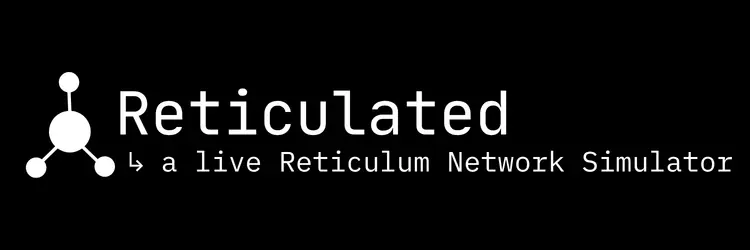
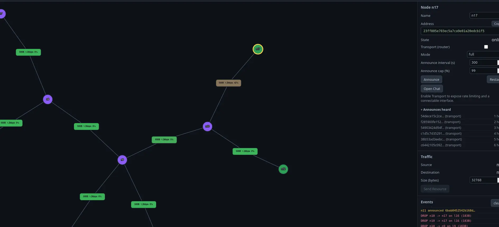
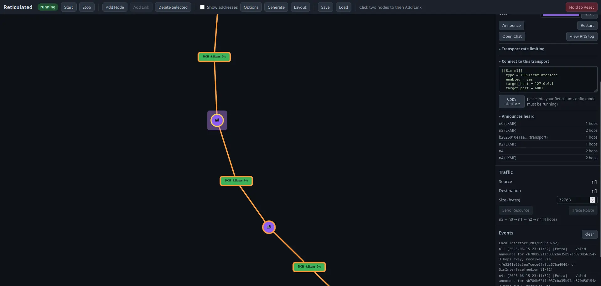

# Reticulated



Reticulated is a Reticulum network simulator that spawns live, interactive
[Reticulum](https://github.com/markqvist/reticulum) instances. It supports
Python Reticulum nodes and mixed networks containing Rust nodes from
[FreeTAKTeam/LXMF-rs](https://github.com/FreeTAKTeam/LXMF-rs). The web UI remains
available, while mixed and automated scenarios can run entirely from the CLI.

You can create networks of any topology and set bitrate, MTU, and configure path loss and propagation behavior. It provides a top-down view to a live network. You can connect any Reticulum application to the simulated network. It also has built in utilities like a basic LXMF chat function and Resource transfer included.





## Requirements

- Python 3.10 or newer.
- The packages in `requirements.txt`. The `rns` package supplies `rnsd`,
  `rnstatus`, and `rnpath`; Reticulated also finds these tools beside the active
  Python interpreter when a virtual environment is not on `PATH`.
- For Rust nodes, an LXMF-rs `reticulumd` binary compatible with version 0.9.6
  or newer. Build it from an LXMF-rs checkout with:

  ```bash
  cargo build --release --manifest-path ../LXMF-rs/Cargo.toml \
    -p reticulumd --bin reticulumd
  export SIM_RUST_RETICULUMD="$PWD/../LXMF-rs/target/release/reticulumd"
  ```

On systems with `uv`, a complete local setup is:

```bash
uv venv .venv
uv pip install --python .venv/bin/python -e .
source .venv/bin/activate
```

With standard Python packaging, use `python -m pip install -e .` instead.

## Web UI

```bash
pip install -r requirements.txt
python run.py
```

Open http://127.0.0.1:8000.

```bash
python run.py --port 9000                 # web UI on 9000
python run.py --host 0.0.0.0 --port 9000  # listen on all interfaces
python run.py --hub-port 5900             # move the medium hub off 5800
SIM_PORT=9000 SIM_HUB_PORT=5900 python run.py
```

Each node's `instance_name` is derived from the data directory under simdata/

Existing topologies without an implementation field remain Python-only. The
HTTP API accepts `"implementation": "python"` or `"rust"` when creating or
updating a node. Endpoint versus transport operation is selected independently
with the existing `transport` node option.

## Headless mixed scenarios

Run the included four-node interoperability smoke with one command:

```bash
reticulated-scenario scenarios/mixed-smoke.json --report mixed-smoke-results.json
```

Run the reproducible 100-node scenario (50 Python, 50 Rust, and a mixed
ten-router backbone) with:

```bash
reticulated-scenario scenarios/mixed-100.json --report mixed-100-results.json
```

Add `--dashboard` to write a standalone HTML dashboard beside the JSON report:

```bash
reticulated-scenario scenarios/mixed-100.json \
  --report mixed-100-results.json \
  --dashboard mixed-100-dashboard.html
```

The dashboard has no server or external asset dependency; open the resulting
HTML file directly in a browser. It visualizes acceptance KPIs, implementation
mix and direction coverage, measured transfer RTT, medium counters, fault
recovery, and the full per-action evidence retained in the report.

To compare this run with any number of earlier or later scenario results:

```bash
reticulated-dashboard results/*.json --output scenario-dashboard.html
```

The generated dashboard embeds the supplied reports and can also accept more
JSON files through its file picker or drag-and-drop area. Running
`reticulated-dashboard --output scenario-dashboard.html` without input reports
creates an empty reusable dashboard. Loaded files remain local to the browser.

The command exits zero only when every required action passes. It always stops
child processes and removes its temporary node directories. Use `--keep` to
retain the data directory for diagnosis. Results contain source and destination
implementations, the expected topology path and hop count, transfer type and
outcome, relevant events, and source/destination log tails. Schema version 2
reports additionally include implementation and transport counts, medium
profiles, action timing, measured sender RTT where available, and a
machine-readable KPI summary. The dashboard remains compatible with older
reports that do not contain these fields.

Generated scenario configuration supports:

```json
{
  "generate": {
    "nodes": 100,
    "rust_nodes": 40,
    "transport_nodes": 10,
    "bitrate": 1000000,
    "mtu": 500,
    "propagation": 0.02,
    "loss": 0.01
  }
}
```

`rust_nodes` controls the exact implementation count; `rust_ratio` can be used
instead. Transport implementations alternate where the requested ratio permits
it. Explicit scenarios can provide the normal exported `topology` object.

Transfer actions accept explicit `mode` (`direct`, `opportunistic`, or
`propagated`), `warmups`, `samples`, and `concurrency`. The `packet`, `link`,
and `resource` action names remain compatible aliases; `direct`,
`opportunistic`, `propagated`, and `cold_path` are also accepted. Every sample
uses a unique correlation ID and a monotonic enqueue-to-receiver observation.
Supported lifecycle actions are `wait_ready`, `announce`, `restart`,
`shutdown`, `start`, `disconnect`, `reconnect`, `partition`, `recover`, and
`sleep`. A partition action identifies a medium and
groups that may communicate internally:

```json
{"action":"partition","medium":"l0","groups":[["n0","n2"],["n1","n3"]]}
```

`recover` removes that partition. `disconnect` and `reconnect` mute or restore
one node on one medium without killing the process.

## Python/Rust lab

`reticulated-lab` consumes the authoritative case inventory and pinned Python
references from a sibling LXMF-rs checkout. It does not maintain a second
conformance definition:

```bash
reticulated-lab conformance \
  --lxmf-rs ../LXMF-rs \
  --profile smoke \
  --output-dir results/conformance-smoke
```

`smoke` selects the canonical direct, opportunistic, propagated, Resource, and
path-discovery cases in the directions exposed by the LXMF-rs harness.
`standard` executes every live and local-policy case advertised by that
harness. `full` adds the channel, paper, remote-relay, and optional pinned
reference-conformance slices. Every case is recorded as pass, fail, or an
explicit skip with its command, duration, and diagnostic log. Reference commit
mismatches fail before execution; `--allow-unpinned` is available only for
diagnostic reports, which are marked non-conforming.

Matched composition benchmarks use the same seeded topology/media graph for
Python-only, 50/50 mixed, and Rust-only cells:

```bash
reticulated-lab benchmark \
  --profile smoke \
  --seed 20260720 \
  --output-dir results/benchmark-smoke
```

The mixed assignment balances both endpoints and transport relays and covers
Python→Python, Python→Rust, Rust→Python, and Rust→Rust at selected matched route
depths. The workload includes cold discovery; 256-byte direct, opportunistic,
and propagated delivery; 16 KiB Resources; and sustained direct and Resource
traffic. Composition order rotates between standard/full runs.

Performance remains informational unless both a compatible baseline report and
a threshold file are supplied:

```bash
reticulated-lab benchmark --profile smoke --seed 20260720 \
  --output-dir results/benchmark-guarded \
  --baseline results/benchmark-smoke/benchmark-smoke.json \
  --thresholds scenarios/lab-thresholds.toml
```

Schema-v3 reports retain raw correlated samples, p50/p95/p99 and relative MAD,
delivery rate, goodput, convergence time, retries, topology seed, implementation
roles, process-tree CPU/peak RSS, pinned Python revisions, the LXMF-rs commit,
and the Rust binary SHA-256. Missing platform counters are explicitly marked
unavailable. The generated standalone dashboard accepts schema v1/v2 scenario
reports as well as schema v3 scenario, conformance, and benchmark reports, and
adds composition/direction filters, variability/goodput, resource evidence,
coverage, and baseline status.

## How Rust nodes connect

Reticulated remains the simulated medium and control plane. Each Rust node is a
separate `reticulumd` process. For every simulated medium attached to that
node, Reticulated starts a small local adapter:

```text
reticulumd TCP client -- standard Reticulum HDLC -- adapter
adapter -- Reticulated interface envelope -- shared medium hub
```

The adapter removes or adds only interface framing. Raw RNS packet bytes pass
unchanged to the existing medium hub, where the configured bitrate, MTU,
propagation delay, and loss are applied. No packet-validation changes or Rust
protocol exceptions are used. No LXMF-rs source patch is required because its
standard HDLC TCP interface and local daemon RPC already expose the necessary
integration points. Rust announce, discovery, link-backed packet,
and Resource operations use `reticulumd`'s local MessagePack RPC; Python
Reticulum remains the interoperability reference.

Rust-cell measurements include the local bridge and daemon RPC work because
that is the deployed end-to-end path. They are intentionally labeled network
results, not protocol-core microbenchmarks.

The port ranges can be overridden with `SIM_RUST_BRIDGE_BASE`,
`SIM_RUST_RPC_BASE`, `SIM_RUST_RPC_HOST`, `SIM_RUST_BRIDGE_STRIDE`, and the existing hub variables.
The scenario runner selects an isolated local range automatically.

## Automation API

The web server also exposes lifecycle and fault controls:

- `POST /api/nodes/{node}/start`, `/shutdown`, or `/restart`;
- `POST /api/nodes/{node}/medium` with `medium` and `connected`;
- `POST /api/media/{medium}/partition` with `groups`;
- `POST /api/media/{medium}/recover`.

Status and path inspection continue through `/api/status`,
`/api/paths/{node}`, and `/api/route`. Rust status and announces are read from
the Rust daemon RPC; Python status continues to use the reference RNS tools.

## Validation

Fast tests that do not start network processes are:

```bash
python -m unittest discover -s tests -v
```

The mixed smoke is the quick live interoperability test. It verifies packet and
Resource transfers in both Python/Rust directions across a mixed multi-hop
transport path, then performs a post-restart correlated transfer that rejects
stale delivery evidence. The lab smoke commands above are the acceptance
checks for the canonical conformance inventory and matched three-composition
benchmark.

## Known limitations

- The graphical editor currently creates Python nodes by default. Configure
  Rust nodes through scenario JSON or the HTTP API; the UI can still display
  and control the resulting topology.
- `reticulumd` must be built separately. Reticulated does not download or build
  LXMF-rs during a test, which keeps CI inputs explicit and reproducible.
- Small direct payloads normally use link packets and larger payloads use RNS
  Resources. Explicit opportunistic, propagated, and cold-path actions exercise
  those distinct live paths and retain receiver events and Rust/Python logs.
- Topology hop reporting is the configured expected route. Per-node learned
  path tables are separately available from the status/path APIs.
- A Rust node supports up to `SIM_RUST_BRIDGE_STRIDE` attached media (16 by
  default). Increase the stride before starting the simulator for denser
  per-node topologies.
